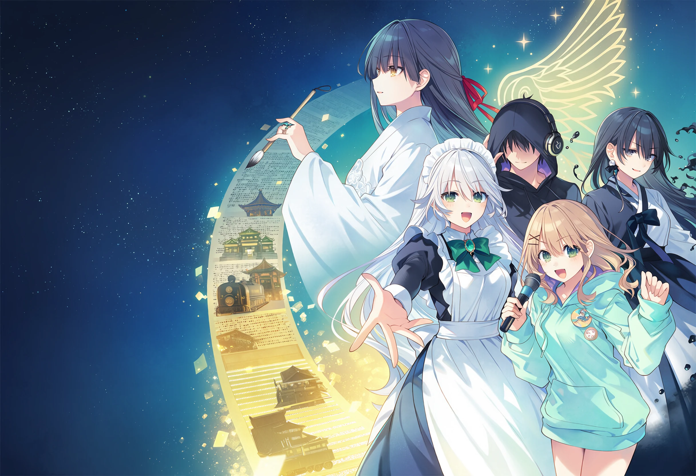

<div align="center">


# 연표 오르페이아

### 얼굴 없는 작곡가와 역사덕후 보컬

**한국사능력검정시험 심화 기출로 공부하는 비주얼 노벨**



[▶ 바로 플레이](https://skybridge805679-netizen.github.io/orpheia-history/) · 설치 없이 브라우저에서

`기출 550문항` · `예상 문제 162문항` · `핵심노트 98개` · `서장 + 23장 + 종장` · `히로인 34명` · `엔딩 38종` · `외전 3편`

</div>

---

## 어떤 이야기인가요

> **윤슬** 「그래서 결론. 오빠, 다음 앨범은 역사다.」
>
> **윤슬** 「역사 노래 내 봐, 고증러들 떼로 몰려와. 하나 틀리면 바로 박제야.」

얼굴을 한 번도 드러낸 적 없는 작곡가 **상철**, 그의 여동생이자 보컬이자 못 말리는 역사덕후 **윤슬**,
그리고 상철이 3년 전 믹싱용으로 만든 작업 AI — 메이드 스킨을 입은 **오르페이아(電脳侍女)**.

윤슬의 부탁으로 기출 550문항과 인터넷 암기 글을 한꺼번에 읽은 밤,
이유 없이 외워졌다 버려진 조각들이 엉겨 먹물 계정 **묵**이 태어난다.
묵이 단 거짓 댓글을 따라 연표가 시험지 순서대로 번지기 시작하고, 기록으로 만들어진 오르페이아도 함께 번진다.

고치는 방법은 하나. **사람이 그 장면을 직접 보고 납득하는 것.**
셋은 오르페이아의 MV 장면 엔진으로 「연표 다이브」를 해, 그 시대를 살던 소녀들을 만나 번진 기록을 되돌린다.

<table>
<tr>
<td></td>
<td></td>
</tr>
<tr>
<td></td>
<td></td>
</tr>
</table>

## 이렇게 공부합니다

| | |
|---|---|
| 📖 **알려 주고 나서 풀기** | 문제 앞에서 그 시대 인물과 칠판 판서가 자료 단서 → 시대·인물 → 그때 있었던 일을 먼저 보여 줍니다. 「일단 풀어 봐」는 없어요. |
| ⏪ **되감기** | 틀리면 고른 보기의 진짜 주인(어느 시대·누구·무슨 제도)을 보여 주고 다시 고르게 합니다. 점수는 첫 시도만. |
| ⚔️ **묵 배틀** | 첫 시도에 맞힐 때마다 묵의 먹물 옷이 한 자락씩 찢어지고, 틀리면 오르페이아의 의상 데이터가 버그로 깨집니다. 11장부터는 아군 **사연**이 합류해 「잔향」을 함께 봉인해요. |
| 🎤 **가사 고증 검수** | 귀환하면 윤슬이 쓴 가사에서 틀린 줄을 찾아냅니다. 맞히면 발매 뒤 팬 댓글이 먹물의 거짓말을 반박하고, 놓치면… 댓글창이 헷갈려요. |
| 📊 **발매 정산** | 장마다 구독자·고증 신뢰도·호감도가 정산되고, 그 장의 MV가 공개됩니다. |
| 🏅 **합격 발표** | 이야기 전체의 첫 시도 정답률로 1급·2급·3급, 또는 낙방 엔딩이 결정됩니다. |

## 연표의 소녀들

다이브 장면마다 그 시대를 살던 소녀가 길잡이가 됩니다. 배울 사실은 그 사람의 사정·소원·두려움 속에 들어 있어요.

| 장 | 제목 | 범위 | 이끄는 사람 |
|---|---|---|---|
| 서장 | 얼굴 없는 작곡가와 역사덕후 보컬 | 80회 채점, 첫 다이브 | 윤슬 |
| 1 | 누리의 돌 | 선사 | 노을(굴을 뛰쳐나온 범) · 누리 |
| 2 | 하늘의 자손, 다섯 나라의 축제 | 고조선·여러 나라 | 노을 → 달래 |
| 3 | 한강의 주인 | 삼국·가야 | 나루(건넘의 신령) · 은실 · 이랑 |
| 4 | 살수에서 기벌포까지 | 수·당 전쟁, 삼국 통일 | 아라 · 가온 |
| 5 | 바다 동쪽의 번성한 나라 | 통일 신라·발해 | 해랑 · 울림(종의 비천) |
| 6 | 천 년의 저녁 | 신라 하대·후삼국 | 사연 · 나루 · 사라 · 하늬 |
| 7 | 호족의 나라에서 문벌의 나라로 | 고려 전기 | 마루 · 서리 |
| 8 | 벽란도의 가짜 약혼자 | 고려 경제·문화 | 여울 · 울림 |
| 9 | 칼과 말발굽의 시대 | 무신 정권~고려 말 | 쇠별 · 울림 · 단비 |
| 10 | 새 나라의 설계도 | 조선 건국~성종, 통치 기구 | 소담 · 고요(경복궁의 그늘) |
| 11 | 붓의 다툼, 칼의 바다 | 사화~병자호란 | 소담 · 도담 · 나루 |
| 12 | 상복과 탕평비 | 예송~세도 정치 | 기방 자매(매향·초련·화선·설아) · 초아 |
| 13 | 장터의 노래, 실학의 붓 | 조선 후기 경제·사회·문화 | 단오 · 바다 |
| 14 | 검은 배, 세 번의 격변 | 흥선 대원군~을미사변 | 가람 · 소담 · 보리 · 고요 |
| 15 | 황제의 나라, 전차가 달리는 거리 | 독립 협회·대한 제국·근대 문물 | 한별 · 엘리 · 고요 |
| 16 | 빼앗긴 도장, 지키려는 손 | 러일 전쟁~국권 피탈 | 보리 · 한별 |
| 17 | 칼 찬 교사와 만세의 봄 | 1910년대·3·1 운동·임시 정부 | 한별 · 보리 |
| 18 | 부드러운 손, 숨은 칼 | 1920년대 민족 운동 | 한별 · 보리 |
| 19 | 경성의 두 얼굴 | 일제 강점기 사회·문화 | 한별 |
| 20 | 이름을 빼앗긴 밤, 광복의 새벽 | 1930년대~광복 | 보리 · 한별 · 새벽 |
| 21 | 둘로 갈린 새벽 | 광복~6·25 전쟁, 이승만 정부 | 새벽 |
| 22 | 4월의 교복, 6월의 거리 | 4·19~6월 민주 항쟁 | 새벽 · 봄내 · 다솜 |
| 23 | 선을 넘는 걸음 | 민주화 이후 정부, 통일 노력 | 다솜 · 새벽 · 모아 |
| 종장 | 연표의 끝에서 | 주제사·문화유산·지역사, 81회 | 모두 |
| 외전 | 고모의 육아지옥 · 열여덟 무당의 야간 근무 · 새벽의 아침 | 히든 엔딩 뒤 | 윤슬 · 혜진 · 새벽 |

## 그리고 더

- **엔딩 38종** — 오르페이아 · 히로인 34명 · 묵 화해 · 낙방 「노래는 남았다」, 그리고 첫 시도 전부 정답일 때만 열리는 히든 엔딩 「연표의 신부들」과 애프터 스토리 「오늘을 산다」.
- **기출 풀기** — 시대별 · 회차별 · 오답 노트 · 출제 비중대로 뽑는 「제81회 예상 모의고사」 50문항.
- **🎮 미니게임** — 연표 꿰기 · 누구일까요 · 짝 맞추기 · 이 유물은? · 먼저일까?(60초 O/X), 엔딩 뒤 「💍 아내 대결」.
- **갤러리** — CG · 음악 · 회상 · 엔딩 · 묵 의상 도감 · 👤 인물 프로필.
- **세이브 24칸** + 오토 · 퀵 세이브, 장 선택.

---

## 만드는 사람을 위한 안내

빌드가 없는 정적 페이지입니다. `python3 -m http.server`로 띄우고 `index.html`을 엽니다(GitHub Pages 그대로 가능).
작업 규칙은 `CLAUDE.md`, 인물은 `docs/인물-설정.md`, 학습 설계는 `docs/학습-설계.md`.

장 id(`ch08`·`ch09`)는 세이브 호환 때문에 그대로 두고, 순서는 `index.html` 스크립트 순서와 장 제목 번호로 정한다(8장 = `ch09`, 9장 = `ch08`).

그림은 NovelAI로 장마다 새로 그린다(`tools/nai-assets.json` → GitHub Actions `nai-assets.yml`이 없는 그림만 생성).
개발 중 특정 장부터 시작하려면 콘솔에서 `VN._dev('ch14')`.

### 데이터

문항·해설·자료 그림 목록·핵심노트는 `data/`에 있다.
기출 그림(WebP 사본)과 요약노트(`summary.css`·`summary-render.js`·`summary/*.js`)는 `assets/kh/`에 있다.

### 구조

```
index.html          스크립트 목록
core.js             공용 도우미, 문항 기록(localStorage)
vn.js               이야기 엔진(철도 ADV의 엔진을 옮겨 넓힘) — 대본 문법, 배틀, 갤러리, 세이브
quiz.js             기출 문제 화면(@quiz)과 「기출 풀기」 로비
bgm.js · sfx.js     음악·효과음(효과음은 Web Audio 합성)
story/chNN-*.js     장 대본 · story/spNN-*.js 외전
data/               기출 데이터
assets/             캐릭터·배경·CG(WebP, NovelAI 생성 → waifu2x 2배), BGM
tools/              NAI 생성·업스케일, 예상 문제, 통독(playthrough.js)
```

### 대본에서 기출 부르기

```
@quiz 80-15 80-37          특정 문항
@quiz era=고려 n=3         시대에서 3문항(안 푼 문항 우선)
@quiz round=80             회차 전체
@if quizFirst >= 1 -> good 결과 분기 (quizFirst: 첫 시도 정답 수, quizTotal: 문항 수, quizAll: 이야기 누적)
```
대사 안의 `{quizFirst}` 같은 표시는 그 값으로 바뀐다.
